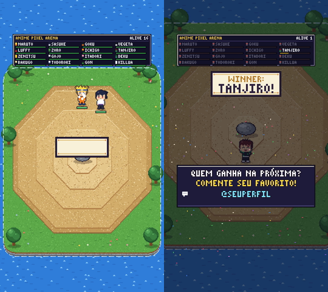
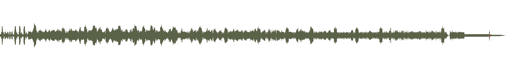

# Ficha técnica do vídeo modelo — arena-preview

> Gerada por `scripts/analisar-modelo.py`. Números são estimativas automáticas: confira olhando `quadros.png` e `onda.png`.

## Formato
- Duração: **90.0 s** · 1080×1920 (vertical 9:16) · 30.0 fps

## Ritmo de edição
- Cenas detectadas: **2** · 0.02 cortes/s → perfil **calmo/editorial**
- Duração média por cena: **45.0 s** (mín. 2.9 s · máx. 87.2 s)
- Cortes em: 87.15s (suave)
- Tipo predominante: **transições suaves (fade/slide/blur)**

## Áudio
- BPM provável: **144** · alternativas: 72, 112 (confira batendo o pé junto com o vídeo)
- Loudness: **-14.0 LUFS** · pico -2.4 dBFS
- Ataques fortes (prováveis efeitos sonoros/batidas): 25 — 0.16s, 0.56s, 0.95s, 1.23s, 1.49s, 1.76s, 2.02s, 4.95s, 8.80s, 13.37s, 26.73s, 29.93s, 33.81s, 34.92s, 37.20s
- Cortes com ataque sonoro junto (±0,3 s): **1/1** → edição sincronizada com som (whoosh/impacto nos cortes)

## Preencher olhando os quadros (Claude + pessoa)
- Tipos de transição percebidos: 
- Estilo de texto (fonte, tamanho, animação): 
- Paleta / tratamento de cor: 
- Efeitos sonoros percebidos: 
- O que **copiar** do modelo: 
- O que **não** copiar (ajustar à nossa marca): 

